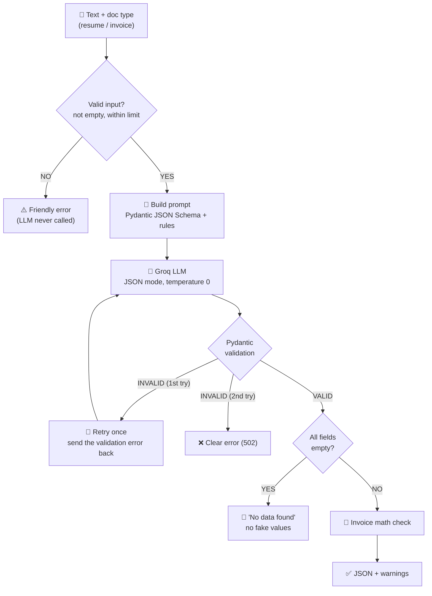

<div align="center">

# 🧾 Data Extraction Bot

### Turn messy resumes and invoices into clean, validated JSON.
**The LLM extracts. Pydantic verifies. Python double-checks the math.**


[Quick Start](#-installation) · [Architecture](#-architecture) · [Pipeline](#-extraction-pipeline) · [Edge Cases](#-edge-case-handling) · [Why Groq](#-why-groq-and-not-openai) · [Interview FAQ](#-interview-cheat-sheet)

</div>

---

## 📑 Table of Contents

1. [Overview](#-overview)
2. [Objective](#-objective)
3. [Tech Stack](#-tech-stack)
4. [Architecture](#-architecture)
5. [Extraction Pipeline](#-extraction-pipeline)
6. [Schemas](#-schemas)
7. [Hallucination Prevention](#-hallucination-prevention)
8. [Edge Case Handling](#-edge-case-handling)
9. [Why Groq (and not OpenAI)](#-why-groq-and-not-openai)
10. [Environment Variables](#-environment-variables)
11. [Installation](#-installation)
12. [How to Run](#-how-to-run)
13. [Example](#-example)
14. [Limitations](#-limitations)
15. [Interview Cheat Sheet](#-interview-cheat-sheet)

---

## ✨ Overview

**Data Extraction Bot** takes unstructured text (a resume or an invoice) and returns structured JSON that has been **validated against a Pydantic schema**, not just "JSON-shaped".

| | |
|---|---|
| 🎯 **Schema-driven** | Pydantic models define exactly what the output must look like |
| ✅ **Validated** | Every response is parsed and checked. Invalid output triggers one automatic retry |
| 🧮 **Math-checked** | Invoice totals are re-calculated in Python. Mismatches are flagged, not trusted |
| 🛡️ **Honest** | Missing facts stay `null`. Text with no relevant data returns an error, never fake values |
| ♻️ **Resilient** | Empty input, rate limits, bad keys, retired models and bad JSON give friendly messages, no crashes |
| 🎨 **Two interfaces** | Streamlit UI with a masked API key panel, and a FastAPI endpoint with Swagger docs |

```text
"INVOICE #INV-2026-044 ... 2 x Laptop stand @ 1500 ... Total: INR 4484"
                         │
                         ▼
{ "invoice_number": "INV-2026-044", "currency": "INR",
  "line_items": [{ "description": "Laptop stand", "quantity": 2.0, ... }],
  "total": 4484.0 }
```

## 🎯 Objective

Build an app that **takes unstructured text (like resumes or invoices) and uses an LLM to output clean, structured JSON**, while demonstrating:

- an understanding of how structured output works beyond a one-line wrapper,
- explicit handling of edge cases (API rate limits, empty input, no relevant data, hallucinations),
- complete documentation (setup, `.env`, running the app).

| Task Type | Objective | Key Tech Stack |
|---|---|---|
| Data Extraction Bot | Unstructured text to clean, structured JSON | Pydantic, Groq (`openai/gpt-oss-120b`), FastAPI, Streamlit |

## 🧰 Tech Stack

| Layer | Technology | Role |
|---|---|---|
| Language | **Python 3.10+** | Application code |
| UI | **Streamlit** | Dark UI, stat cards, tables, JSON tab, key panel |
| API | **FastAPI** | `POST /extract`, `/health`, Swagger docs |
| Validation | **Pydantic v2** | Schemas, JSON Schema generation, output validation |
| LLM | **Groq** running `openai/gpt-oss-120b` | Reads the text and fills the schema |
| Output mode | **JSON mode** (`response_format: json_object`) + schema in the prompt | Guarantees valid JSON syntax |
| Config | **python-dotenv** | Loads `.env` |
| Tests | **pytest** | 20 offline tests (mocked Groq, no key needed) |

## 🏗️ Architecture



### Project structure

```
data-extraction-bot/
├── app/
│   ├── config.py          # .env settings
│   ├── schemas.py         # Pydantic models (Resume, Invoice, API types)
│   ├── extractor.py       # LLM call, validation, retry, error handling
│   ├── storage.py         # Saves results so they can be opened by URL
│   ├── main.py            # FastAPI routes
│   └── static/index.html  # Simple built-in web page
├── .streamlit/
│   └── config.toml        # Dark theme
├── tests/
│   ├── test_extractor.py  # Extraction logic + API tests
│   ├── test_storage.py    # Result URLs + path-safety tests
│   └── test_ui.py         # Streamlit smoke tests
├── streamlit_app.py       # Streamlit frontend
├── requirements.txt       # Python dependencies
├── .env.example           # Template for environment variables
├── .env                   # Your real secrets (git-ignored, you create this)
├── .gitignore
└── README.md
```

## 🔄 Extraction Pipeline

| # | Step | What happens | Implementation |
|---|---|---|---|
| 1 | **Receive** | User pastes text and picks a type | Streamlit / `POST /extract` |
| 2 | **Validate input** | Reject empty or oversized text before any API call | `extract()` |
| 3 | **Prompt** | System prompt contains the schema's JSON Schema and strict rules | `_system_prompt()` |
| 4 | **Call LLM** | JSON mode, `temperature=0`, low reasoning effort for gpt-oss | `client.chat.completions.create` |
| 5 | **Validate output** | Parse and check against the Pydantic model | `model_validate_json` |
| 6 | **Retry** | On failure, send the error text back to the model once | retry loop |
| 7 | **Empty check** | If everything is null or empty, return "no data found" | `_is_empty()` |
| 8 | **Sanity check** | Invoice line items and totals are recalculated | `_check_invoice()` |
| 9 | **Return** | Validated dict plus a `warnings` list | Streamlit / JSON response |

**Why JSON mode and not strict structured outputs?** JSON mode guarantees *syntactically* valid JSON. It does not guarantee the right fields or types, so Pydantic does that part. The schema is placed in the prompt so the model knows the target shape.

**Why `reasoning_effort=low`?** `openai/gpt-oss-120b` is a reasoning model. Extraction is a simple task, so low effort keeps it fast and cheap. The app only sends this option for `openai/gpt-oss*` models.

## 📐 Schemas

| Document | Fields |
|---|---|
| 📄 **Resume** | `full_name`, `email`, `phone`, `location`, `summary`, `skills[]`, `experience[]` (company, title, start/end date, description), `education[]` (institution, degree, field, year), `certifications[]` |
| 🧾 **Invoice** | `invoice_number`, `vendor_name`, `customer_name`, `invoice_date`, `due_date`, `currency`, `line_items[]` (description, quantity, unit price, total), `subtotal`, `tax`, `total` |

Every scalar is optional (`null` when absent) and every list defaults to `[]`, so a missing fact is represented honestly instead of being guessed.

## 🛡️ Hallucination Prevention

```
         Messy text goes in
                   │
       ┌───────────▼───────────┐
Layer 1│  Strict prompt         │  "Use ONLY facts in the text. Never guess.
       │  + temperature 0       │   null for missing, [] for empty lists."
       └───────────┬───────────┘
                   ▼
       ┌───────────────────────┐
Layer 2│  Pydantic validation   │  wrong types / shapes are rejected,
       │  + one guided retry    │  the model sees the error and fixes it
       └───────────┬───────────┘
                   ▼
       ┌───────────────────────┐
Layer 3│  Code-level checks     │  empty result = error, invoice math is
       │                        │  recomputed, mismatches become warnings
       └───────────────────────┘
```

1. **Prompt discipline.** Only facts in the text are allowed, missing values must be `null`, and `temperature=0` removes creative drift.
2. **Schema enforcement.** Pydantic rejects anything that does not fit, and the retry shows the model its own mistake.
3. **Verification in code.** LLMs are unreliable at arithmetic, so Python checks that line items sum to the subtotal and that subtotal + tax = total.

## 🧯 Edge Case Handling

| Edge case | Behaviour | HTTP |
|---|---|:---:|
| Empty / whitespace input | ⚠️ "Input text is empty." No API call is spent | 422 |
| Input over `MAX_INPUT_CHARS` | ⚠️ Rejected with the limit shown | 422 |
| Text has no relevant data (all fields null) | 🚫 "No invoice data found", no fake data | 422 |
| Missing `GROQ_API_KEY` | ❌ Tells you where to get a free key | 500 |
| Wrong / rejected key | ❌ "Groq rejected the API key" | 500 |
| Groq free-tier rate limit | ❌ Friendly "wait a few seconds and retry" | 429 |
| Retired / invalid model name | ❌ Tells you to set `GROQ_MODEL` and restart | 502 |
| Groq unreachable / no internet | ❌ "Could not reach Groq" | 502 |
| Other Groq HTTP errors (400, 5xx) | ❌ "Groq returned an error (HTTP ...)" | 502 |
| Model returns invalid or off-schema JSON | 🔁 One automatic retry with the error, then a clear message | 502 |
| Invoice numbers do not add up | ⚠️ Returned with `warnings` | 200 |
| Invalid `doc_type` in the API | 🚫 Rejected by Pydantic | 422 |

> ℹ️ In the Streamlit UI, every one of these appears as a readable message instead of a stack trace.

## 🔧 Why Groq (and not OpenAI)

The assignment mentions OpenAI Structured Outputs, but the OpenAI API is **pay-as-you-go**. An account with no credits fails on the very first call:

```text
openai.RateLimitError: Error code: 429 - insufficient_quota
```

### 🔍 Root cause

| Question | Answer |
|---|---|
| Is it a bug in the code? | ❌ No. The request is valid |
| Is it a normal rate limit? | ❌ No. It uses HTTP 429, but it is a **billing** error |
| Will retrying help? | ❌ No. It fails until credits are added or another provider is used |

### 🎯 The decision: Groq only

| Reason | Why it matters |
|---|---|
| 🆓 **Free tier** | The project runs without paying |
| ♻️ **Reproducible** | Anyone who clones the repo can run it with a free key |
| 🔁 **Same chat-completions pattern** | The skill transfers directly to OpenAI later |
| ⚡ **Fast** | Low latency, the UI feels instant |

**About the model:** `openai/gpt-oss-120b` is an open-weight model released by OpenAI that runs **on Groq's servers**. You need only a Groq key, never an OpenAI account.

**Honest trade-offs:** the free tier is rate-limited (handled with a friendly 429 message), and any model can occasionally return output that fails validation (handled by the retry).

## 🔐 Environment Variables

Create a `.env` file in the project root (a template is provided in `.env.example`):

| Variable | Required | Default | Description |
|---|---|---|---|
| `GROQ_API_KEY` | ✅ | n/a | Free key from [console.groq.com/keys](https://console.groq.com/keys) |
| `GROQ_MODEL` | ❌ | `openai/gpt-oss-120b` | Any Groq chat model. If one is retired, set a current one |
| `MAX_INPUT_CHARS` | ❌ | `12000` | Longer inputs are rejected with a clear error |
| `RESULTS_DIR` | ❌ | `data/results` | Where saved JSON results are written |
| `API_BASE_URL` | ❌ | `http://127.0.0.1:8000` | Base of the links shown in the UI |

```env
GROQ_API_KEY=gsk_your_key_here
GROQ_MODEL=openai/gpt-oss-120b
```

> 🔑 **Streamlit shortcut:** you can paste the key in the sidebar for the current session instead. It is masked (`gsk_••••••••abcd`), never written to disk, and the **Test key** button verifies it.

> ⚠️ **Never commit `.env`.** It is already in `.gitignore`. Only `.env.example` belongs in the repo. `.env` is read at startup, so **restart the app after editing it**.

## 📦 Installation

```bash
# 1. Clone the repository
git clone <your-repo-url>
cd data-extraction-bot

# 2. Create and activate a virtual environment
python -m venv .venv
.venv\Scripts\activate             # macOS / Linux: source .venv/bin/activate

# 3. Install dependencies
pip install -r requirements.txt

# 4. Configure environment variables
cp .env.example .env               # Windows: copy .env.example .env
# then open .env and paste your GROQ_API_KEY
```

## 🚀 How to Run

**Web UI (recommended)**

```bash
streamlit run streamlit_app.py
```

Open <http://localhost:8501>, then:

1. Pick **Resume** or **Invoice**.
2. Click **Load sample**, paste your own text, or upload a `.txt` file.
3. Click **✨ Extract**.
4. Switch between the **Formatted** and **JSON** tabs, and use **Download JSON**.

**REST API**

```bash
uvicorn app.main:app --reload
```

| Endpoint | Method | Description |
|---|:---:|---|
| `/` | GET | Simple built-in web page |
| `/docs` | GET | Swagger UI |
| `/health` | GET | Shows the model and whether a key is set |
| `/extract` | POST | Send `{"text": "...", "doc_type": "resume"\|"invoice"}`. Response includes `id` and `url` |
| `/results/{id}` | GET | 🔗 **Open the saved JSON by URL** (works in the browser) |
| `/results` | GET | Newest saved results with their URLs |

```bash
curl -X POST http://127.0.0.1:8000/extract \
  -H "Content-Type: application/json" \
  -d '{"doc_type": "invoice", "text": "INVOICE #42 Vendor: Sai Traders Total: INR 4484"}'
```

**Tests**

```bash
python -m pytest -q        # 20 offline tests, no key needed
```

## 🧪 Example

| Input | Result |
|---|---|
| A full resume | ✅ Name, contact, skills, jobs, education as structured JSON |
| An invoice with correct math | ✅ Clean JSON, `warnings: []` |
| An invoice where the total is wrong | ⚠️ JSON plus a warning such as *"Subtotal + tax = 4484, but total is 999"* |
| *(empty)* | ⚠️ **Input text is empty. Paste a resume or invoice.** |
| *"hello world"* as an invoice | 🚫 **No invoice data found in the text.** |

Sample API response:

```json
{
  "doc_type": "invoice",
  "model": "openai/gpt-oss-120b",
  "data": {
    "invoice_number": "INV-2026-044",
    "vendor_name": "Sai Traders",
    "currency": "INR",
    "subtotal": 3800.0,
    "tax": 684.0,
    "total": 4484.0,
    "line_items": [{ "description": "Laptop stand", "quantity": 2.0, "unit_price": 1500.0, "total": 3000.0 }]
  },
  "warnings": [],
  "id": "a1b2c3d4e5f6",
  "url": "http://127.0.0.1:8000/results/a1b2c3d4e5f6"
}
```

### 🔗 JSON data URL

Every extraction is saved as a small file, and its URL is shown in the Streamlit **JSON** tab (with an **Open JSON in browser** button) and returned by `POST /extract`.

1. Start the API: `uvicorn app.main:app --reload`
2. Extract something, then open the URL, for example `http://127.0.0.1:8000/results/a1b2c3d4e5f6`
3. List recent results at `http://127.0.0.1:8000/results`

Results are stored in `data/results/` (git-ignored). IDs are random 12-character hex strings and are strictly validated, so path tricks like `../` return 404. These links work on your machine only. Delete the folder to remove saved data.

> 📸 Add screenshots to a `screenshots/` folder and link them here: ``

## ⚠️ Limitations

- **Text only.** You can paste text or upload `.txt`. PDFs and images are not read yet.
- **Two document types.** Resume and invoice. Other types need a new Pydantic model and a registry line.
- **Dates stay as written.** They are kept as strings (for example `Jun 2022`), not converted to ISO dates.
- **JSON mode, not strict schema mode.** Pydantic catches shape errors after the fact, so a rare failure after the one retry still returns an error.
- **The model can misread messy text.** Code checks the invoice math, but it cannot verify every extracted fact.
- **Provider limits.** Groq's free tier is rate-limited, and model names can be retired over time.
- **No authentication on the API.** Add auth before exposing `/extract` publicly.
- **Saved results are local.** URLs work only on your machine and files stay in `data/results/` until you delete them.
- **Privacy.** Text you extract is sent to Groq. Do not paste data you are not allowed to share.

## 🎤 Interview Cheat Sheet

<details>
<summary><b>Why validate with Pydantic if the LLM already returns JSON?</b></summary>

Valid JSON is not the same as the right JSON. JSON mode guarantees syntax only. Wrong types, missing fields and unexpected shapes still slip through. Pydantic enforces the contract, and on failure I send the error back to the model for one corrective retry.
</details>

<details>
<summary><b>How does the model know the output format?</b></summary>

I generate the JSON Schema from the Pydantic model with `model_json_schema()` and put it in the system prompt. The same model is then used to validate the reply, so the schema in the prompt and the validator can never drift apart.
</details>

<details>
<summary><b>How do you prevent hallucinations?</b></summary>

Three layers. A strict prompt says to use only facts in the text and `null` otherwise, with `temperature=0`. Pydantic rejects malformed output. Code then returns an error if everything is empty and recalculates invoice math, turning mismatches into warnings.
</details>

<details>
<summary><b>Why check invoice math in code?</b></summary>

LLMs are unreliable at arithmetic. If the model misreads one number, line items will not match the subtotal, and the code catches that. The result is flagged instead of silently trusted.
</details>

<details>
<summary><b>How do you handle API rate limits and failures?</b></summary>

The extractor catches Groq's specific errors and maps each to a friendly message and HTTP status: rate limit (429), bad key, retired model, no connection, and other HTTP errors. Empty and oversized input are rejected before any API call is spent. The user never sees a stack trace.
</details>

<details>
<summary><b>You planned for OpenAI. What went wrong and how did you fix it?</b></summary>

An OpenAI account with no credits returns `429 insufficient_quota`. That is a billing error, not a code bug and not a normal rate limit, so retrying cannot help. I switched to Groq, which has a free tier and the same chat-completions pattern, and used `openai/gpt-oss-120b`, an open-weight OpenAI model hosted on Groq. The skill transfers directly to OpenAI later.
</details>

<details>
<summary><b>Why Groq's JSON mode and not strict structured outputs?</b></summary>

JSON mode works on every Groq model, so changing `GROQ_MODEL` never breaks the app. Strict schema mode needs every field to be required, which conflicts with honest optional fields (`null` when absent). Pydantic plus a retry gives me the same safety while keeping optional fields.
</details>

<details>
<summary><b>Why <code>temperature=0</code> and low reasoning effort?</b></summary>

Extraction should be deterministic, not creative, so temperature is 0. gpt-oss is a reasoning model, and extraction is simple, so low effort keeps latency and cost down.
</details>

<details>
<summary><b>How is the API key kept safe?</b></summary>

It lives in `.env`, which is git-ignored, and only `.env.example` is committed. In Streamlit the key is shown masked, pasted keys are held only in the browser session, and nothing is written to disk.
</details>

---

<div align="center">

Built for **Task 3: Data Extraction Bot** · Python · Groq · Pydantic · FastAPI · Streamlit

</div>