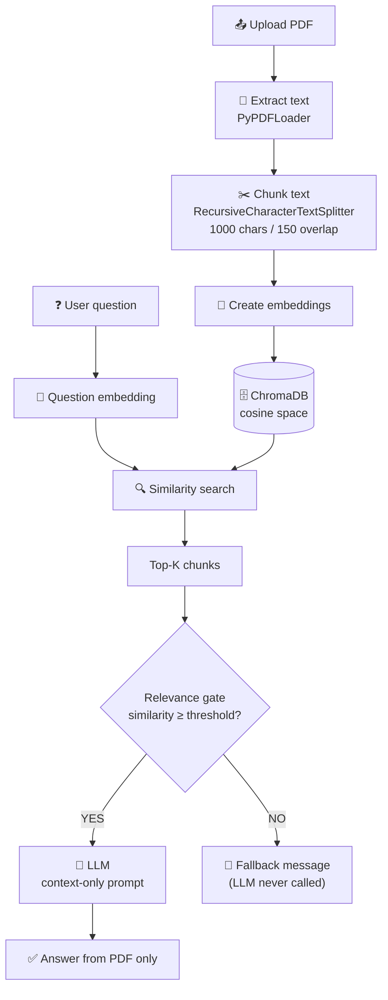
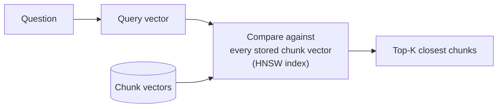

<div align="center">

# 📄 Chat With Your PDF

### A strictly grounded RAG app: ask questions, get answers **only** from your document.


[Quick Start](#-quick-start) · [Architecture](#-architecture) · [How Vector Search Works](#-how-vector-search-works) · [Edge Cases](#-edge-case-handling) · [FAQ](#-interview-cheat-sheet)

</div>

---

## 📑 Table of Contents

1. [Overview](#-overview)
2. [Objective](#-objective)
3. [Tech Stack](#-tech-stack)
4. [Architecture](#-architecture)
5. [RAG Pipeline](#-rag-pipeline)
6. [How Embeddings Work](#-how-embeddings-work)
7. [How Vector Search Works](#-how-vector-search-works)
8. [Cosine Similarity vs Euclidean Distance](#-cosine-similarity-vs-euclidean-distance)
9. [Hallucination Prevention](#-hallucination-prevention)
10. [Edge Case Handling](#-edge-case-handling)
11. [Environment Variables](#-environment-variables)
12. [Installation](#-installation)
13. [How to Run](#-how-to-run)
14. [Example](#-example)
15. [Limitations](#-limitations)
16. [Interview Cheat Sheet](#-interview-cheat-sheet)

---

## ✨ Overview

**Chat With Your PDF** lets you upload a PDF and ask questions about its contents. Every answer is built from passages retrieved from *your* document. If the answer isn't there, the app says so instead of guessing.

| | |
|---|---|
| 🔒 **Grounded answers** | The LLM only sees retrieved document context, and only when it's relevant |
| 🛡️ **Two-layer hallucination guard** | A relevance gate before the LLM, plus a strict context-only prompt |
| 🔬 **Transparent retrieval** | See the retrieved chunks and the cosine / Euclidean maths behind every search |
| ♻️ **Resilient** | Retries with exponential backoff on rate limits; friendly errors; no crashes |

## 🎯 Objective

Build a "Chat with your PDF" tool that extracts text, embeds it, and answers user questions **strictly based on the document**, while demonstrating:

- an understanding of vector search beyond calling a wrapper,
- explicit handling of edge cases (rate limits, empty input, no relevant context, hallucinations),
- complete documentation.

## 🧰 Tech Stack

| Layer | Technology | Role |
|---|---|---|
| Language | **Python 3.10+** | Application code |
| UI | **Streamlit** | Upload, question input, answer display |
| Orchestration | **LangChain** | PDF loading, text splitting, prompts, model clients |
| Vector store | **ChromaDB** (cosine space) | Stores chunk vectors and runs similarity search |
| Embeddings | **OpenAI `text-embedding-3-small`** | Text → vector (always OpenAI; Groq has no embeddings API) |
| LLM | **Groq** `llama-3.3-70b-versatile` *or* **OpenAI** `gpt-4o-mini` (switch in the sidebar) | Writes the final grounded answer |
| Maths | **NumPy** | Manual cosine / Euclidean computation for transparency |

## 🏗️ Architecture



### Project structure

```
task-1-basic-rag/
├── app.py              # Entire application (UI + RAG pipeline)
├── requirements.txt    # Python dependencies
├── .env.example        # Template for environment variables
├── .env                # Your real secrets (git-ignored, you create this)
├── .gitignore
└── README.md
```

## 🔄 RAG Pipeline

| # | Step | What happens | Implementation |
|---|---|---|---|
| 1 | **Upload** | User selects a PDF | `st.file_uploader` |
| 2 | **Extract** | One `Document` per page | `PyPDFLoader` |
| 3 | **Chunk** | Split into ~1000-char pieces with 150-char overlap | `RecursiveCharacterTextSplitter` |
| 4 | **Embed** | Each chunk → vector | `OpenAIEmbeddings` |
| 5 | **Store** | Vectors + text saved | `Chroma` (in-memory, cosine) |
| 6 | **Query** | Question → query vector | `embed_query` |
| 7 | **Search** | Nearest chunks by cosine distance | Chroma collection query |
| 8 | **Gate** | Keep only chunks above the threshold | `similarity ≥ threshold` |
| 9 | **Generate** | LLM answers from relevant chunks only | Strict prompt |
| 10 | **Display** | Answer + sources + maths | Streamlit expanders |

**Why chunk?** Sending a whole PDF to an embedding model or LLM is wasteful and imprecise. Smaller chunks make retrieval targeted, and the 150-character overlap keeps sentences that straddle a boundary intact.

## 🔢 How Embeddings Work

An embedding model turns text into a list of numbers (a **vector**) so that *meaning* becomes *geometry*: texts with similar meaning land close together.

```
"Employees receive 20 days of annual leave."
                    ↓
        [0.12, -0.44, 0.73, 0.21, ...]     ← 1,536 numbers for text-embedding-3-small
```

"How many vacation days do I get?" and "Employees receive 20 days of annual leave." share almost no keywords, but their vectors point in nearly the same direction, which is what makes **semantic search** work.

## 🔍 How Vector Search Works



1. Every chunk was embedded once and stored in ChromaDB.
2. The question is embedded with the **same** model, so both live in the same vector space.
3. Chroma finds the stored vectors closest to the query vector. It uses an **HNSW** (Hierarchical Navigable Small World) graph index for fast *approximate* nearest-neighbour search instead of comparing against every vector.
4. The closest chunks are returned as the Top-K.

> 💡 **Not just a wrapper:** the app's **"🔬 Under the hood"** panel recomputes cosine similarity and Euclidean distance with NumPy for each retrieved chunk and compares them to Chroma's own distance, so you can verify the maths yourself.

## 📐 Cosine Similarity vs Euclidean Distance

| | **Cosine similarity** | **Euclidean distance** |
|---|---|---|
| **Formula** | `(A · B) / (‖A‖ × ‖B‖)` | `√ Σ (Aᵢ − Bᵢ)²` |
| **Measures** | The *angle* between vectors (direction) | The *straight-line gap* between vectors (magnitude + direction) |
| **Range** | −1 to 1 (higher = more similar) | 0 to ∞ (lower = closer) |
| **Ignores vector length?** | ✅ Yes | ❌ No |
| **Typical use** | Text / semantic similarity | Clustering, spatial data |

**Rule of thumb for similarity (illustrative):**

| Cosine | Reading |
|---|---|
| ~0.95 | Highly similar |
| ~0.80 | Relevant |
| ~0.30 | Weak similarity |

> Absolute values depend on the embedding model. OpenAI's models typically give lower scores than this table for good matches, which is why the threshold is adjustable in the sidebar.

**Why cosine for text?** Meaning is encoded in a vector's *direction*. A long paragraph and a short sentence about the same topic can have very different lengths but similar directions. Cosine ignores length, while Euclidean can penalise it.

**Good to know:** for *unit-normalised* vectors (which OpenAI embeddings are), the two metrics are mathematically linked: `‖A − B‖² = 2 − 2·cos(A, B)`, so they rank results identically. This app configures Chroma with `hnsw:space = cosine`, so Chroma returns `distance = 1 − cosine similarity`.

## 🛡️ Hallucination Prevention

The app defends against made-up answers in **two independent layers**:

```
              Retrieved chunks
                     │
        ┌────────────▼────────────┐
 Layer 1│     Relevance gate      │  similarity < threshold for ALL chunks?
        └───────┬───────────┬─────┘
              YES          NO
                │           │
        Fallback message    ▼
        (no LLM call)  ┌────────────────────────┐
                Layer 2│ Strict context-only    │
                       │ prompt, temperature 0  │
                       └────────────────────────┘
```

1. **Retrieval gate.** If no retrieved chunk clears the similarity threshold, the LLM is **never called**. An LLM that is never asked can't invent an answer.
2. **Strict prompt.** When the LLM is called, it is told to answer *only* from the supplied context, to not use outside knowledge, to not make up facts, and to reply with the fallback sentence if the answer isn't present. The context is also marked as data, not instructions, to reduce prompt-injection risk from document text.
3. **Deterministic decoding.** `temperature=0` reduces creative drift.

## 🧯 Edge Case Handling

| Edge case | Behaviour |
|---|---|
| No PDF uploaded | ⚠️ `Please upload a PDF first.` |
| Empty / whitespace question | ⚠️ `Please enter a question.` (no API call) |
| Overlong question | Input capped at 1,000 characters |
| Invalid / corrupted / encrypted PDF | ❌ Friendly message, no crash |
| Empty (0-byte) file | ❌ `The uploaded file is empty.` |
| Scanned / image-only PDF | ❌ `No readable text was found in this PDF.` |
| API rate limit | 🔁 Retries up to 4 times with exponential backoff + jitter, then a friendly error |
| API failure / network error | ❌ `The AI service is temporarily unavailable. Please try again later.` |
| Invalid OpenAI or Groq key | ❌ Clear message naming which key to check in `.env` |
| Missing API key | ❌ Lists exactly which key(s) are missing |
| No relevant context | 🚫 Fallback message; LLM is not called |
| Unrelated question | 🚫 Same fallback, no hallucination |
| Empty LLM response | Falls back to the safe message |
| Any unexpected exception | Caught, logged, friendly error shown |

## 🔐 Environment Variables

Create a `.env` file in the project root (a template is provided in `.env.example`):

| Variable | Required | Default | Description |
|---|---|---|---|
| `OPENAI_API_KEY` | ✅ | n/a | OpenAI key, **always required** (used for embeddings) |
| `GROQ_API_KEY` | ✅ if using Groq | n/a | Groq key (used when the LLM provider is Groq) |
| `LLM_PROVIDER` | ❌ | `groq` if a Groq key exists, else `openai` | Default provider for answers: `groq` or `openai` |
| `GROQ_CHAT_MODEL` | ❌ | `llama-3.3-70b-versatile` | Groq model used for answers |
| `OPENAI_CHAT_MODEL` | ❌ | `gpt-4o-mini` | OpenAI model used for answers |
| `OPENAI_EMBEDDING_MODEL` | ❌ | `text-embedding-3-small` | Model used for embeddings |

> ℹ️ **Why two keys?** Groq serves fast chat models but has no embeddings endpoint, so OpenAI creates the vectors and Groq (or OpenAI) writes the answer. Model names change over time; if one is retired, set the matching `*_CHAT_MODEL` variable.

> ⚠️ **Never commit `.env`.** It's already listed in `.gitignore`. Only `.env.example` belongs in the repo.

## 📦 Installation

```bash
# 1. Clone the repository
git clone <your-repo-url>
cd task-1-basic-rag

# 2. Create and activate a virtual environment
python -m venv .venv
source .venv/bin/activate          # Windows: .venv\Scripts\activate

# 3. Install dependencies
pip install -r requirements.txt

# 4. Configure environment variables
cp .env.example .env               # Windows: copy .env.example .env
# then open .env and paste your real OPENAI_API_KEY and GROQ_API_KEY
```

## 🚀 How to Run

```bash
streamlit run app.py
```

Open the URL shown in the terminal (usually <http://localhost:8501>), then:

1. **Upload** a PDF.
2. **Type** a question.
3. Click **Ask Question**.
4. Expand **📚 Retrieved sources** or **🔬 Under the hood** to inspect how the answer was found.

The sidebar lets you pick the **LLM provider (Groq or OpenAI)** and tune **Top-K** and the **relevance threshold**.

## 🧪 Example

**Document contains:** `Employees receive 20 days of annual leave.`

| Question | Result |
|---|---|
| *How many annual leaves are provided?* | ✅ **Employees receive 20 days of annual leave.** |
| *What is Apple's stock price?* | 🚫 **I couldn't find relevant information in the provided document.** |
| *(empty)* | ⚠️ **Please enter a question.** |

Sample "Under the hood" output (illustrative values):

| Rank | Page | Cosine (manual) | Euclidean (manual) | Chroma distance | Passed gate |
|---|---|---|---|---|---|
| 1 | 4 | 0.5812 | 0.9150 | 0.4188 | ✅ |
| 2 | 4 | 0.4377 | 1.0603 | 0.5623 | ✅ |
| 3 | 7 | 0.1904 | 1.2725 | 0.8096 | ❌ |

## ⚠️ Limitations

- **No OCR.** Scanned / image-only PDFs are detected and rejected rather than read.
- **Threshold is a heuristic.** The default (`0.30`) suits `text-embedding-3-small`; other embedding models may need a different value. If valid questions get the fallback, lower it; if unrelated questions slip through, raise it.
- **One PDF at a time**, held in memory. Closing the session discards the index.
- **Tables, columns and complex layouts** may extract imperfectly.
- **Single-turn Q&A.** There's no conversation memory, so follow-ups must be self-contained.
- **Retrieval limits answer quality.** Questions needing information spread across many distant pages may be only partly answered with a small Top-K.
- Requires an OpenAI API key (embeddings) plus a Groq key if you choose Groq for answers, and network access.

## 🎤 Interview Cheat Sheet

<details>
<summary><b>How does vector search work under the hood?</b></summary>

The embedding model converts both the document chunks and the user query into numerical vectors. ChromaDB compares the query vector with stored vectors using a similarity or distance metric (here, cosine distance via an HNSW index) and returns the most relevant chunks.
</details>

<details>
<summary><b>Cosine similarity vs Euclidean distance?</b></summary>

Cosine similarity measures directional similarity between vectors, while Euclidean distance measures geometric distance. For text embeddings, cosine is commonly preferred because semantic similarity is better represented by vector direction than by magnitude. For normalised vectors, the two give the same ranking.
</details>

<details>
<summary><b>How do you prevent hallucinations?</b></summary>

Two layers. First, a relevance gate: if no chunk clears the similarity threshold, the LLM is never called and a fixed fallback is returned. Second, a strict prompt that restricts the model to the retrieved context, forbids outside knowledge, and gives it an explicit fallback sentence, run at temperature 0.
</details>

<details>
<summary><b>How do you handle API rate limits?</b></summary>

Every embedding and LLM call goes through a retry helper with exponential backoff and jitter. If retries are exhausted, the user sees a friendly message instead of a stack trace.
</details>

<details>
<summary><b>Why chunk with overlap?</b></summary>

Chunking keeps retrieval targeted and within model limits. Overlap (150 characters) prevents information that spans a chunk boundary from being cut in half.
</details>

---

<div align="center">

Built for **Task 1: Basic RAG Pipeline** · Python · LangChain · ChromaDB · Streamlit

</div>
