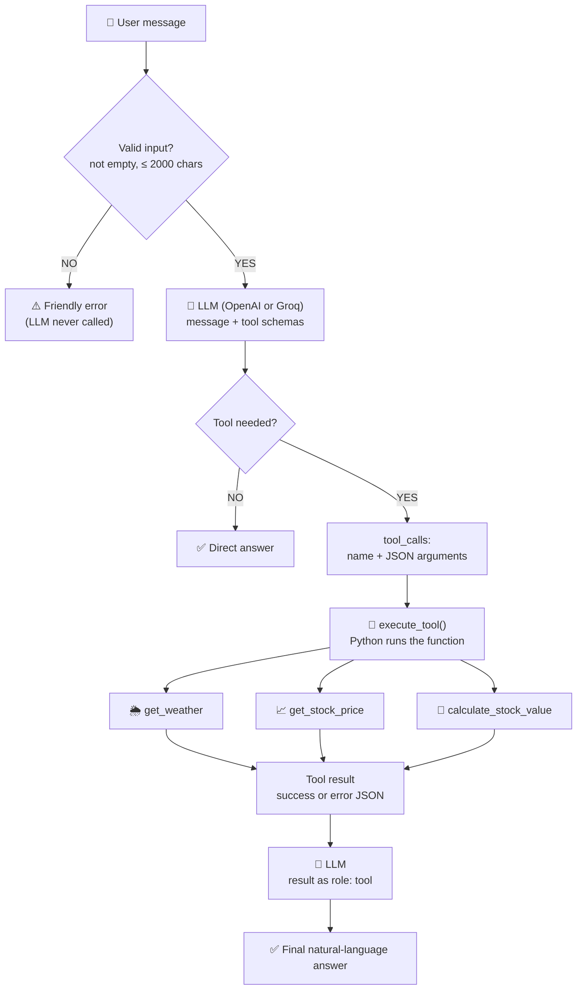
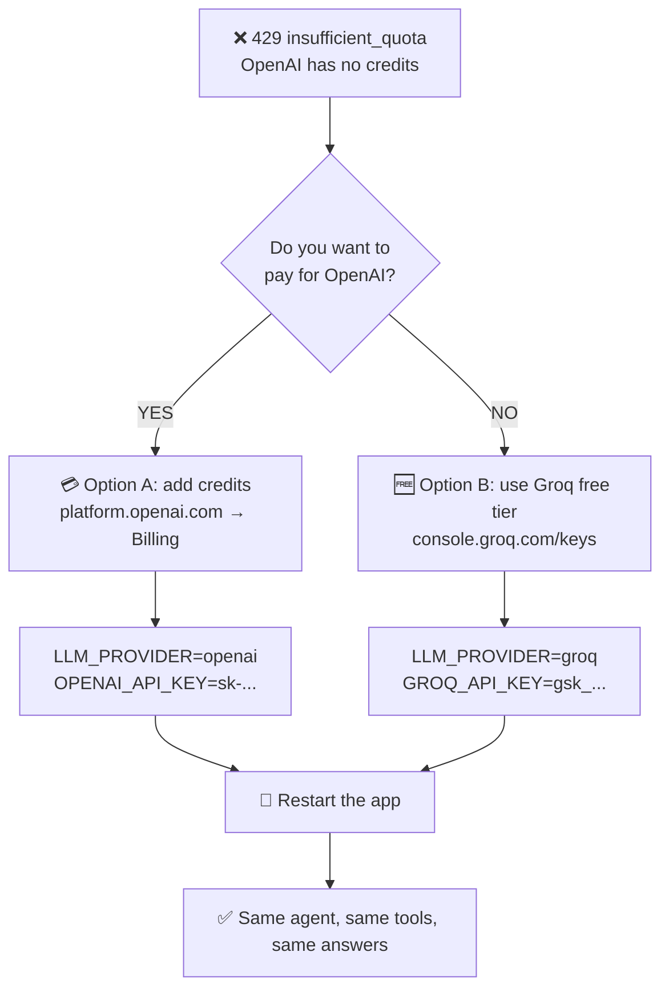

<div align="center">

# 🤖 AI Agent with Tools

### A tool-calling chatbot: the LLM **decides**, Python **executes**.


[Quick Start](#-installation) · [Architecture](#-architecture) · [How Function Calling Works](#-how-function-calling-works) · [Edge Cases](#-edge-case-handling) · [Problem Solved](#-problem-solved-openai-quota-error) · [FAQ](#-interview-cheat-sheet)

</div>

---

## 📑 Table of Contents

1. [Overview](#-overview)
2. [Objective](#-objective)
3. [Tech Stack](#-tech-stack)
4. [Architecture](#-architecture)
5. [Agent Pipeline](#-agent-pipeline)
6. [How Function Calling Works](#-how-function-calling-works)
7. [Available Tools](#-available-tools)
8. [Hallucination Prevention](#-hallucination-prevention)
9. [Edge Case Handling](#-edge-case-handling)
10. [Problem Solved: OpenAI Quota Error](#-problem-solved-openai-quota-error)
11. [Environment Variables](#-environment-variables)
12. [Installation](#-installation)
13. [How to Run](#-how-to-run)
14. [Example](#-example)
15. [Limitations](#-limitations)
16. [Interview Cheat Sheet](#-interview-cheat-sheet)

---

## ✨ Overview

**AI Agent with Tools** is a chatbot that understands what you ask and routes it to the right Python function: weather, stock price, or a stock-value calculation. For greetings and general questions it simply answers without any tool.

| | |
|---|---|
| 🎯 **Intent routing** | The LLM chooses the tool (or none) from the user's message |
| 🐍 **Real execution** | Python runs the tool. The model never executes code |
| 🛡️ **Honest answers** | Tool errors are passed back to the LLM and explained, never invented |
| ♻️ **Resilient** | Timeouts, rate limits, bad keys and bad input produce friendly messages, no crashes |
| 🔀 **Two LLM providers** | Switch between **OpenAI** and **Groq (free)** with one line in `.env` |
| 🎨 **Two interfaces** | Streamlit chat UI and a FastAPI endpoint with Swagger docs |

## 🎯 Objective

Create a chatbot that can **check the weather or calculate stock prices by routing user intents to specific Python functions**, while demonstrating:

- an understanding of function calling beyond using an agent wrapper,
- explicit handling of edge cases (API rate limits, empty input, tool failures, hallucinations),
- complete documentation (setup, `.env`, running the app).

## 🧰 Tech Stack

| Layer | Technology | Role |
|---|---|---|
| Language | **Python 3.10+** | Application code |
| UI | **Streamlit** | Chat interface with tool badges and stats |
| API | **FastAPI** + **Pydantic** | `POST /chat` endpoint, Swagger docs |
| LLM | **OpenAI** `gpt-4o-mini` *or* **Groq** `llama-3.3-70b-versatile` (switch with `LLM_PROVIDER`) | Intent detection, tool selection, final answer |
| Function calling | **OpenAI-style tool calling** (`tools`, `tool_calls`, `role: tool`), identical on both providers | Lets the model request a Python function |
| Weather data | **Open-Meteo** (no key) | Geocoding + current conditions |
| Stock data | **Yahoo Finance** chart endpoint (no key) | Latest available price |
| HTTP | **Requests** | Calls the data APIs with timeouts |
| Config | **python-dotenv** | Loads `.env` |
| Tests | **pytest** | 14 offline tests |

## 🏗️ Architecture



### Project structure

```
ai-agent-tools/
├── app/
│   ├── agent.py          # LLM + tool-calling loop + error handling
│   ├── tools.py          # Python tools + safe dispatcher
│   └── main.py           # FastAPI app (Swagger at /docs)
├── .streamlit/
│   └── config.toml       # Dark theme
├── tests/
│   └── test_agent.py     # 14 offline tests
├── streamlit_app.py      # Web UI
├── cli.py                # Terminal chat
├── requirements.txt      # Python dependencies
├── .env.example          # Template for environment variables
├── .env                  # Your real secrets (git-ignored, you create this)
├── .gitignore
└── README.md
```

## 🔄 Agent Pipeline

| # | Step | What happens | Implementation |
|---|---|---|---|
| 1 | **Receive** | User types a message | Streamlit `chat_input` / `POST /chat` |
| 2 | **Validate** | Reject empty or overlong input before any API call | `run_agent_traced()` |
| 3 | **Prompt** | System prompt + user message + tool schemas sent to the LLM | `client.chat.completions.create` |
| 4 | **Decide** | Model returns plain text, or `tool_calls` | OpenAI or Groq (`LLM_PROVIDER`) |
| 5 | **Parse** | Tool arguments decoded from JSON | `json.loads` |
| 6 | **Execute** | The named Python function runs | `execute_tool()` |
| 7 | **Return** | Result appended as a `role: tool` message with the same `tool_call_id` | Message list |
| 8 | **Answer** | Model turns the result into natural language | Second LLM call |
| 9 | **Loop guard** | Stops after 5 tool rounds | `MAX_TOOL_ROUNDS` |
| 10 | **Display** | Answer, tool badge and response time | Streamlit |

**Why a loop?** A model may call several tools or chain them. The loop keeps going until the model answers in plain text, with a hard cap of 5 rounds so it can never run forever.

## 🧠 How Function Calling Works

You describe each tool with a **JSON schema**. The model reads the schemas plus the user's message and decides whether a tool is needed.

```json
{
  "type": "function",
  "function": {
    "name": "get_weather",
    "description": "Get the current weather for a city.",
    "parameters": {
      "type": "object",
      "properties": { "city": { "type": "string" } },
      "required": ["city"]
    }
  }
}
```

If a tool is needed, the model does **not** run anything. It returns a request like this:

```json
{ "name": "get_weather", "arguments": "{\"city\": \"Pune\"}" }
```

Then:

```
LLM    → decides   ("call get_weather with city = Pune")
Python → executes  (get_weather(city="Pune") hits the weather API)
Python → returns the result to the LLM as a role: tool message
LLM    → writes    ("The current weather in Pune is ...")
```

> 💡 **The golden rule: LLM = decides. Python = executes.** The model never runs code, and `execute_tool()` only runs functions from a fixed allow-list (`TOOL_REGISTRY`), so the model cannot call anything else.

## 🧩 Available Tools

| Tool | Triggered by | Input | Source |
|---|---|---|---|
| 🌦️ `get_weather` | "What is the weather in Pune?" | `city` | Open-Meteo |
| 📈 `get_stock_price` | "What is Apple's stock price?" | `symbol` (e.g. `AAPL`) | Yahoo Finance |
| 🧮 `calculate_stock_value` | "How much are 10 Tesla shares worth?" | `symbol`, `quantity` | Price × quantity |
| 💬 *(no tool)* | "Hello", "What is Generative AI?" | n/a | LLM answers directly |

The model converts company names to tickers itself (Apple → `AAPL`, Microsoft → `MSFT`, Tesla → `TSLA`).

## 🛡️ Hallucination Prevention

The agent defends against made-up numbers in **three layers**:

```
         User asks for live data
                   │
       ┌───────────▼───────────┐
Layer 1│   Data comes from a    │  weather / price is fetched by Python,
       │   real tool, not the   │  never recalled from model memory
       │   model's memory       │
       └───────────┬───────────┘
                   ▼
       ┌───────────────────────┐
Layer 2│ Structured tool errors │  {"success": false, "error": "..."}
       └───────────┬───────────┘
                   ▼
       ┌───────────────────────┐
Layer 3│ Strict system prompt   │  "If a tool returns an error, explain it
       │ + low temperature      │   honestly and NEVER invent weather or prices"
       └───────────────────────┘
```

1. **Tool-grounded data.** Live weather and prices come from the APIs, not from what the model remembers.
2. **Structured errors.** Unknown city, unknown ticker, timeout or rate limit all return `{"success": false, "error": ...}` instead of an empty or fake value.
3. **Strict prompt and `temperature=0.2`.** The system prompt forbids inventing values, and low temperature reduces creative drift.

## 🧯 Edge Case Handling

| Edge case | Behaviour |
|---|---|
| Empty / whitespace message | ⚠️ `Please enter a question.` (no API call) |
| Overlong message (over 2000 chars) | ⚠️ Asks the user to shorten it |
| Missing API key | ❌ Names the exact key to add for the active provider |
| Wrong / invalid key | ❌ `... authentication failed. Please check your <KEY>.` |
| **OpenAI out of credits (`insufficient_quota`)** | 💳 Explains it is billing and shows the fix (add credits or `LLM_PROVIDER=groq`) |
| Normal rate limit | ❌ Friendly "rate-limited, try again" message |
| LLM timeout / connection / HTTP error | ❌ Specific friendly message for each |
| Invalid or retired model name | ❌ Tells the user to set `GROQ_MODEL` / `OPENAI_MODEL` |
| Malformed tool call from the model | 🔁 Automatic retry once, then a clear error |
| Unknown tool requested by the model | 🚫 `Unknown tool: ...` returned to the model |
| Bad / missing tool arguments | 🚫 Structured error, no crash |
| Weather / stock API timeout | ❌ `... request timed out. Please try again.` |
| Weather / stock API rate limit (HTTP 429) | ❌ `... rate limit exceeded. Please try again later.` |
| No internet | ❌ `Could not connect to ...` |
| Unknown city | 🚫 `City '...' was not found.` |
| Unknown stock symbol | 🚫 `No price data found for symbol '...'.` (no invented price) |
| Stock host down | 🔁 Falls back to a second Yahoo host |
| Share quantity ≤ 0 or not a number | 🚫 `Quantity must be greater than zero.` / `must be a number` |
| Endless tool loop | 🛑 Stopped after 5 rounds |
| Any unexpected exception | Caught, friendly error shown |

> ℹ️ The API returns **HTTP 200** even for these friendly errors, on purpose. The error text is in the `response` field.

## 🔧 Problem Solved: OpenAI Quota Error

The assignment lists **OpenAI Function Calling**, so the project was first built on the OpenAI API. The first real call failed:

```text
openai.RateLimitError: Error code: 429 - {'error': {'message': 'You have no credits
remaining. Add credits to continue using the API at
https://platform.openai.com/settings/organization/billing/.',
'type': 'insufficient_quota', 'param': None, 'code': 'credit_balance_exhausted'}}
```

### 🔍 Root cause

| Question | Answer |
|---|---|
| Is it a bug in the code? | ❌ No. The request was valid and reached OpenAI |
| Is it a normal rate limit? | ❌ No. It uses HTTP 429, but it is a **billing** error (`insufficient_quota`) |
| Why did it happen? | The OpenAI API is **pay-as-you-go** and the account had **no credits** |
| Will retrying help? | ❌ No. It fails until credits are added or another provider is used |

### 🧭 How to solve it (two options)



| | 💳 Option A: OpenAI | 🆓 Option B: Groq (default) |
|---|---|---|
| **Fix** | Add billing credits to your OpenAI account | Create a free Groq key |
| **`.env`** | `LLM_PROVIDER=openai`<br/>`OPENAI_API_KEY=sk-...` | `LLM_PROVIDER=groq`<br/>`GROQ_API_KEY=gsk_...` |
| **Default model** | `gpt-4o-mini` | `llama-3.3-70b-versatile` |
| **Cost** | Paid per use | Free tier (rate-limited) |
| **Code changes** | ✅ None | ✅ None |

**Step by step**

1. Open `.env` and set `LLM_PROVIDER` to `openai` or `groq`.
2. Add the matching key (`OPENAI_API_KEY` or `GROQ_API_KEY`).
3. **Restart** the app, because `.env` is only read at startup.
4. Confirm the provider in the Streamlit sidebar. It shows `Provider: OpenAI · Model: gpt-4o-mini` or the Groq equivalent.

**Quick key test (OpenAI example):**

```bash
python -c "import os; from dotenv import load_dotenv; load_dotenv(); from openai import OpenAI; r=OpenAI(api_key=os.getenv('OPENAI_API_KEY')).chat.completions.create(model='gpt-4o-mini', messages=[{'role':'user','content':'Say hello'}]); print(r.choices[0].message.content)"
```

### 🛡️ The app now handles this error gracefully

Instead of crashing, an out-of-credits OpenAI account shows a friendly message with the fix:

> *OpenAI reports no credits left (insufficient_quota). Add billing credits, or switch to the free option: set LLM_PROVIDER=groq and add GROQ_API_KEY in .env.*

This behaviour is covered by an automated test.

### 🎯 Why Groq is the default

| Reason | Why it matters |
|---|---|
| 🆓 **Free tier** | The project runs without paying |
| ♻️ **Reproducible** | Anyone who clones the repo can run it with a free key |
| 🔁 **Same function-calling pattern** | Uses `tools` / `tool_calls` / `role: tool`, so the skill transfers directly to OpenAI |
| ⚡ **Fast** | Low latency makes the chat feel instant |
| 🔀 **Swappable** | One line in `.env` changes the provider |

**Honest trade-offs:** the Groq free tier has rate limits (handled with a friendly message), and Llama occasionally emits a malformed tool call (the agent retries once). OpenAI models are generally very reliable at tool calling but need paid credits.

## 🔐 Environment Variables

Create a `.env` file in the project root (a template is provided in `.env.example`):

| Variable | Required | Default | Description |
|---|---|---|---|
| `LLM_PROVIDER` | ❌ | auto (Groq if its key exists, else OpenAI) | `groq` or `openai` |
| `GROQ_API_KEY` | ✅ if `groq` | n/a | Free key from [console.groq.com/keys](https://console.groq.com/keys) |
| `GROQ_MODEL` | ❌ | `llama-3.3-70b-versatile` | Any Groq model that supports tool calling |
| `OPENAI_API_KEY` | ✅ if `openai` | n/a | Key from [platform.openai.com](https://platform.openai.com/api-keys) (needs billing credits) |
| `OPENAI_MODEL` | ❌ | `gpt-4o-mini` | Any OpenAI model your account can use |
| `BOT_NAME` | ❌ | `Robo` | Chatbot's name in the UI and chat |
| `STOCK_USE_DEMO` | ❌ | `false` | `true` = clearly-labelled **demo** prices for offline testing |

```env
# Free option (default)
LLM_PROVIDER=groq
GROQ_API_KEY=gsk_your_key_here

# Paid option (needs OpenAI credits)
# LLM_PROVIDER=openai
# OPENAI_API_KEY=sk-your_key_here

BOT_NAME=Robo
STOCK_USE_DEMO=false
```

> ℹ️ You only need the key for the provider you choose. The weather and stock tools need **no API keys**. Model names change over time; if one is retired, set `GROQ_MODEL` or `OPENAI_MODEL` to a current one.

> ⚠️ **Never commit `.env`.** It's already listed in `.gitignore`. Only `.env.example` belongs in the repo. `.env` is read at startup, so restart the app after editing it.

## 📦 Installation

```bash
# 1. Clone the repository
git clone <your-repo-url>
cd ai-agent-tools

# 2. Create and activate a virtual environment
python -m venv venv
venv\Scripts\activate              # macOS / Linux: source venv/bin/activate

# 3. Install dependencies
pip install -r requirements.txt

# 4. Configure environment variables
cp .env.example .env               # Windows: copy .env.example .env
# then open .env, choose LLM_PROVIDER and paste the matching API key
```

## 🚀 How to Run

**Web UI (recommended)**

```bash
streamlit run streamlit_app.py
```

Open <http://localhost:8501>, then:

1. **Click an example** in the sidebar, or type a question.
2. Watch the **tool badge** (🌦️ 📈 🧮) appear under the answer.
3. Use **Clear chat** to reset the counters.

**REST API**

```bash
uvicorn app.main:app --reload
```

Open <http://127.0.0.1:8000/docs> → `POST /chat` → **Try it out**.

| Endpoint | Method | Description |
|---|:---:|---|
| `/` | GET | Health check |
| `/docs` | GET | Swagger UI |
| `/openapi.json` | GET | OpenAPI schema |
| `/chat` | POST | Send `{"message": "..."}` and get `{"response": "..."}` |

```bash
curl -X POST http://127.0.0.1:8000/chat \
  -H "Content-Type: application/json" \
  -d '{"message": "What is the weather in Pune?"}'
```

**Terminal chat and tests**

```bash
python cli.py
python -m pytest -q        # 14 offline tests, no keys needed
```

## 🧪 Example

| Question | Tool | Result |
|---|---|---|
| *hi* | none | 💬 Direct greeting |
| *What is the weather in Pune?* | 🌦️ `get_weather` | ✅ Temperature, humidity, wind and conditions for Pune |
| *What is Apple's stock price?* | 📈 `get_stock_price("AAPL")` | ✅ Latest AAPL price in USD |
| *What is Microsoft's stock price?* | 📈 `get_stock_price("MSFT")` | ✅ Latest MSFT price in USD |
| *How much are 10 Tesla shares worth?* | 🧮 `calculate_stock_value` | ✅ Price × 10 |
| *What is Generative AI?* | none | 💬 Direct explanation |
| *(empty)* | none | ⚠️ **Please enter a question.** |
| *What is XYZQ stock price?* | 📈 `get_stock_price` | 🚫 Honest "no price data found" |
| *Weather in Xyzabcd* | 🌦️ `get_weather` | 🚫 Honest "city not found" |

Sample API response:

```json
{ "response": "The current weather in Pune, India is 32.7 °C with mainly clear skies, 34% humidity and a 9.2 km/h wind." }
```

Sample tool result passed back to the model (illustrative values):

```json
{ "success": true, "symbol": "AAPL", "name": "Apple Inc.", "price": 225.5,
  "currency": "USD", "exchange": "NasdaqGS", "source": "Yahoo Finance (may be delayed)" }
```

> 📸 Add screenshots to a `screenshots/` folder and link them here: ``

## ⚠️ Limitations

- **Stock prices may be delayed.** Yahoo's chart endpoint is unofficial and free, so don't call the data real-time. It can also rate-limit or change without notice.
- **Weather is current conditions only.** No forecasts or history.
- **Single-turn Q&A.** There is no conversation memory, so follow-ups must be self-contained.
- **The model picks the ticker.** Ambiguous company names (or companies listed on several exchanges) may map to the wrong symbol.
- **Provider limits.** Groq's free tier is rate-limited, and OpenAI needs paid credits.
- **Llama tool calls can occasionally be malformed.** The agent retries once, but a rare failure can still surface as an error message.
- **Only three tools.** New abilities need a new function, a schema entry and a registry line.
- **No authentication on the API.** Add auth before exposing `/chat` publicly.
- Requires internet access and an API key for one provider (Groq or OpenAI).


---

<div align="center">

Built for **Task 2: AI Agent with Tools** · Python · OpenAI / Groq · FastAPI · Streamlit

</div>
