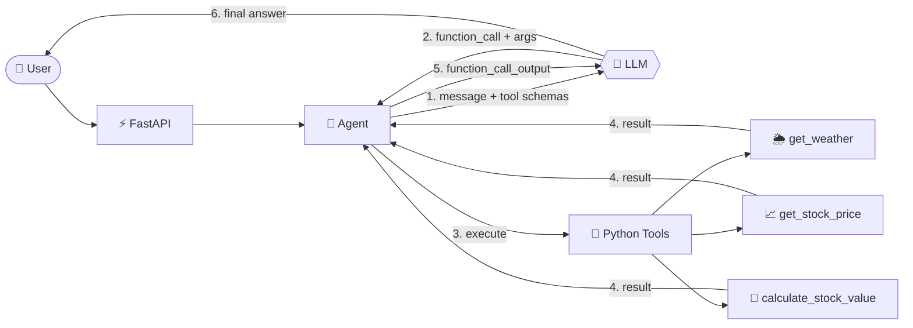

<div align="center">

# 🤖 AI Agent with Tools

### An LLM that *decides*. Python that *executes*.

Understands what you want, picks the right tool, runs real code, and answers in plain English.
Built on the **OpenAI Responses API**, with **no LangChain black box**.


[✨ Features](#-features) • [⚡ Quick Start](#-quick-start) • [🧠 How It Works](#-how-it-works) • [🧪 Try It](#-try-it) • [🛡️ Edge Cases](#️-edge-cases-handled) • [🎤 Interview Notes](#-interview-notes)

</div>

---

## ✨ Features

| | Feature | Details |
|---|---|---|
| 🎯 | **Intent routing** | The LLM picks the right tool, or none for small talk |
| 🌦️ | **Live weather** | Temperature, humidity, wind and conditions for any city |
| 📈 | **Stock prices** | Looks up "Apple" as `AAPL` and fetches the latest price |
| 🧮 | **Stock calculator** | "What are 10 Tesla shares worth?" → price × quantity |
| 🛡️ | **Bulletproof errors** | Rate limits, timeouts, bad input and unknown tools never crash it |
| 🧠 | **Zero hallucinated data** | If a tool fails, the agent says so instead of inventing numbers |
| 🔑 | **Only one API key** | Weather and stock tools are free and need no keys |
| 🎨 | **Streamlit chat UI** | Dark gradient design, tool badges, example prompts and stats |
| 🧪 | **Offline tests** | The test suite runs without internet or an OpenAI key |

---

## ⚡ Quick Start

```bash
# 1. Clone and enter the project
git clone <your-repo-url> && cd ai-agent-tools

# 2. Virtual environment
python -m venv venv
venv\Scripts\activate            # Windows
# source venv/bin/activate       # macOS / Linux

# 3. Install

# 4. Configure
cp .env.example .env             # then add your OPENAI_API_KEY

# 5. Run 🚀
uvicorn app.main:app --reload
Open **http://127.0.0.1:8000/docs** → `POST /chat` → **Try it out** ✅

### 🎨 Web UI (Streamlit)

```bash
streamlit run streamlit_app.py
```

Opens at **http://localhost:8501** with a dark chat interface, clickable example prompts, live tool badges (🌦️ 📈 🧮) and usage stats.

> 💻 Prefer the terminal? Run `python cli.py` for an interactive chat.

### ⚙️ Environment variables

| Variable | Required | Description |
|---|:---:|---|
| `OPENAI_API_KEY` | ✅ | Your OpenAI API key |
| `OPENAI_MODEL` | ➖ | Any model your account can use (default `gpt-4o-mini`) |
| `STOCK_USE_DEMO` | ➖ | `true` = clearly-labelled **demo** prices for offline testing |

> 🔒 Never commit your real `.env`. It is already in `.gitignore`.

---

## 🧠 How It Works



### The golden rule

> **LLM = decides.  Python = executes.**
> The model never runs code. It only returns a tool name and JSON arguments, and `execute_tool()` runs the real function.

### Three behaviours, one agent

| Input | What happens |
|---|---|
| `"Hello"` | 💬 No tool → direct answer |
| `"Weather in Pune?"` | 🔧 `get_weather("Pune")` → result → answer |
| `"Price of Apple stock?"` | 🔧 Apple → `AAPL` → `get_stock_price("AAPL")` → answer |

---

## 🧪 Try It

```bash
curl -X POST http://127.0.0.1:8000/chat \
  -H "Content-Type: application/json" \
  -d '{"message": "What is the weather in Pune?"}'
```

```json
{ "response": "The current weather in Pune is 27°C with clear skies, 48% humidity and light winds." }
```

| # | Test input | Expected behaviour |
|:-:|---|---|
| 1 | `What is the weather in Pune?` | 🌦️ calls `get_weather` |
| 2 | `What is Apple's stock price?` | 📈 calls `get_stock_price("AAPL")` |
| 3 | `What are 10 shares of Tesla worth?` | 🧮 calls `calculate_stock_value` |
| 4 | `What is Generative AI?` | 💬 answers directly, no tool |
| 5 | *(empty message)* | ⚠️ `Please enter a question.` |
| 6 | `Price of XYZ stock?` | 🚫 honest "not found", no made-up price |
| 7 | `Weather in Xyzabcd` | 🚫 "city not found" explained clearly |

**Run the automated tests (no keys needed):**

```bash
python -m pytest -q
```

---

## 🛡️ Edge Cases Handled

<details>
<summary><b>Click to expand all 15+ edge cases</b></summary>

**Input validation**
- ✅ Empty or whitespace-only message (caught *before* the LLM call)
- ✅ Overly long message (over 2000 characters)

**LLM / OpenAI**
- ✅ Missing API key
- ✅ Invalid or unavailable model name
- ✅ Authentication failure
- ✅ Rate limit / quota exceeded
- ✅ Timeout, connection error and HTTP errors
- ✅ Infinite tool loops (capped at 5 rounds)

**Tools / external APIs**
- ✅ API timeout
- ✅ HTTP 429 rate limit
- ✅ No internet connection
- ✅ Invalid or unparseable API response
- ✅ Unknown city or stock symbol
- ✅ Unknown tool name requested by the model
- ✅ Malformed tool arguments
- ✅ Unexpected tool exceptions

</details>

---

## 🗂️ Project Structure

```
ai-agent-tools/
├── 📁 app/
│   ├── agent.py       # 🧠 LLM + tool-calling loop + error handling
│   ├── tools.py       # 🐍 Python tools + safe dispatcher
│   └── main.py        # ⚡ FastAPI app (Swagger at /docs)
├── 📁 .streamlit/
│   └── config.toml    # 🎨 Dark theme
├── 📁 tests/
│   └── test_agent.py  # 🧪 9 offline tests
├── streamlit_app.py   # 🎨 Web UI
├── cli.py             # 💻 Terminal chat
├── .env.example
├── requirements.txt
└── README.md
```

## 🧰 Tech Stack

`Python` · `OpenAI Responses API` · `Function Calling` · `FastAPI` · `Streamlit` · `Pydantic` · `Requests` · `python-dotenv` · `pytest`

**Data sources:** [Open-Meteo](https://open-meteo.com) (weather) · [Stooq](https://stooq.com) (stocks, which may be delayed)

---

## 🎤 Interview Notes

<details>
<summary><b>How does function calling work internally?</b></summary>

I describe each tool with a JSON schema (name, description, parameters). The model decides whether a tool is needed and returns a `function_call` with the name and arguments. My Python code executes the function, then sends the result back as a `function_call_output` with the same `call_id`. The model uses it to write the final answer.
</details>

<details>
<summary><b>Is the LLM executing Python?</b></summary>

No. The LLM only emits `{"name": "get_weather", "arguments": {"city": "Pune"}}`. My application validates and runs the function. The model decides and Python executes.
</details>

<details>
<summary><b>Why not just use LangChain?</b></summary>

I built on the raw API so I could show I understand the mechanism: schemas, the tool loop, call IDs and error propagation. LangChain agents wrap this same loop.
</details>

<details>
<summary><b>How do you prevent hallucinated data?</b></summary>

Tools return `{"success": false, "error": ...}` on failure, and the system prompt forbids inventing weather or prices. The model explains the failure instead.
</details>

<details>
<summary><b>Is the stock data real-time?</b></summary>

It is the latest available price from Stooq and may be delayed, so I don't call it real-time. `STOCK_USE_DEMO=true` uses fake prices that are labelled as demo data.
</details>

---

## 🔭 Roadmap

- [ ] 💬 Conversation memory across turns
- [ ] 🌊 Streaming responses
- [ ] 🔁 Retry with exponential backoff on tool APIs
- [ ] 🔗 LangChain version for side-by-side comparison
- [ ] 🐳 Dockerfile

---

<div align="center">

**Built with ❤️ using Python & OpenAI**

⭐ Star this repo if it helped you!

</div>
