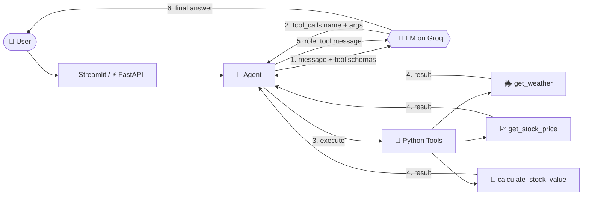

<div align="center">
🤖 AI Agent with Tools
An LLM that decides. Python that executes.
Understands what you want, picks the right tool, runs real code, and answers in plain English.
Powered by Groq (fast Llama inference) with native function calling and no LangChain black box.


✨ Features • ⚡ Quick Start • 🧠 How It Works • ✅ Verified Results • 🔄 Why Not OpenAI? • 🛡️ Edge Cases • 🩺 Troubleshooting • 🎤 Interview Notes
</div>
---
✨ Features
	Feature	Details
🎯	Intent routing	The LLM picks the right tool, or none for small talk
🌦️	Live weather	Temperature, humidity, wind and conditions for any city
📈	Stock prices	Maps "Apple" to `AAPL` and fetches the latest available price
🧮	Stock calculator	"What are 10 Tesla shares worth?" → price × quantity
🛡️	Bulletproof errors	Rate limits, timeouts, bad input and unknown tools never crash it
🧠	No invented data	If a tool fails, the agent says so instead of making up numbers
🔑	One API key	Weather and stock tools are free and need no keys
🎨	Streamlit chat UI	Dark gradient design, tool badges, example prompts and live stats
🏷️	Custom bot name	Set `BOT_NAME` in `.env` and the whole app uses it
🧪	Offline tests	12 tests that run without internet or an API key
---
⚡ Quick Start
```bash
# 1. Clone and enter the project
git clone <your-repo-url> && cd ai-agent-tools

# 2. Virtual environment
python -m venv venv
venv\Scripts\activate            # Windows
# source venv/bin/activate       # macOS / Linux

# 3. Install
pip install -r requirements.txt

# 4. Configure
cp .env.example .env             # Windows: copy .env.example .env
# then open .env and add your GROQ_API_KEY

# 5. Run 🚀
streamlit run streamlit_app.py   # web UI at http://localhost:8501
```
Prefer an API? Run `uvicorn app.main:app --reload` and open http://127.0.0.1:8000/docs → `POST /chat` → Try it out.
Prefer the terminal? Run `python cli.py`.
⚙️ Environment variables
Variable	Required	Description
`GROQ_API_KEY`	✅	Free key from console.groq.com/keys
`GROQ_MODEL`	➖	Any Groq model with tool calling (default `llama-3.3-70b-versatile`)
`BOT_NAME`	➖	Chatbot's name in the UI and chat (default `Robo`)
`STOCK_USE_DEMO`	➖	`true` = clearly-labelled demo prices for offline testing
```env
GROQ_API_KEY=gsk_your_key_here
GROQ_MODEL=llama-3.3-70b-versatile
BOT_NAME=Robo
STOCK_USE_DEMO=false
```
> 🔒 Never commit your real `.env`. It is already in `.gitignore`. Only `.env.example` is public.
> ♻️ `.env` is read at startup, so restart the app after editing it.
---
🧠 How It Works

The golden rule
> **LLM = decides.  Python = executes.**
> The model never runs code. It only returns a tool name and JSON arguments, and `execute_tool()` runs the real function.
Three behaviours, one agent
Input	What happens
`"Hello"`	💬 No tool → direct answer
`"Weather in Pune?"`	🔧 `get_weather("Pune")` → result → answer
`"Price of Apple stock?"`	🔧 Apple → `AAPL` → `get_stock_price("AAPL")` → answer
Data sources
Tool	Source	API key
Weather	Open-Meteo (geocoding + forecast)	❌ none
Stocks	Yahoo Finance chart endpoint (may be delayed)	❌ none
---
✅ Verified Results
Output from a real run of the Streamlit app (live data, so numbers change over time):
#	User question	Tool used	Result
1	`hi`	none	Direct greeting, no tool called ✅
2	`What is the weather in Pune?`	🌦️ `get_weather`	Pune, India: 32.7 °C, 34% humidity, 9.2 km/h wind, mainly clear ✅
3	`What is Apple's stock price?`	📈 `get_stock_price`	Apple (`AAPL`) price in USD, NasdaqGS ✅
4	`What is Microsoft's stock price?`	📈 `get_stock_price`	Microsoft (`MSFT`) price in USD, NasdaqGS ✅
The UI counters matched: 4 questions asked, 3 tools used (the greeting used none).
> 📸 Add your screenshots to a `screenshots/` folder and link them here:
> ``
Test cases to try
#	Test input	Expected behaviour
1	`What is the weather in Pune?`	🌦️ calls `get_weather`
2	`What is Apple's stock price?`	📈 calls `get_stock_price("AAPL")`
3	`How much are 10 Tesla shares worth?`	🧮 calls `calculate_stock_value`
4	`What is Generative AI?`	💬 answers directly, no tool
5	(empty message)	⚠️ `Please enter a question.`
6	`What is XYZQ stock price?`	🚫 honest "not found", no made-up price
7	`Weather in Xyzabcd`	🚫 "city not found" explained clearly
Run the automated tests (no keys needed):
```bash
python -m pytest -q
```
---
🔄 Why Groq and Not the OpenAI API?
The assignment lists OpenAI Function Calling, so this project was first built on the OpenAI API. The first real call failed:
```text
openai.RateLimitError: Error code: 429 - {'error': {'message': 'You have no credits
remaining. Add credits to continue using the API at
https://platform.openai.com/settings/organization/billing/.',
'type': 'insufficient_quota', 'param': None, 'code': 'credit_balance_exhausted'}}
```
🔍 What the error really means
Question	Answer
Is it a bug in the code?	❌ No. The request was valid and reached OpenAI
Is it a normal rate limit?	❌ No. It shares HTTP 429 but is a billing error (`insufficient_quota`)
Why did it happen?	The OpenAI API is pay-as-you-go. The account had no credits, so every request is refused
Will retrying help?	❌ No. It fails until paid credits are added
🎯 Why Groq was the better choice here
#	Reason	Why it matters
1	Free tier	Works without paying anything, so the project runs today
2	Reproducible	Anyone who clones the repo (a reviewer, an interviewer) can run it with a free key
3	Same tool-calling format	Uses the OpenAI-style `tools` / `tool_calls` / `role: tool` pattern, so the skill transfers 1:1
4	Fast responses	Low latency keeps the chat feeling instant
5	Open-weight Llama model	Less vendor lock-in
6	Provider stays swappable	Only the client code is provider-specific
⚖️ Honest trade-offs
	OpenAI API	Groq API
Cost to start	Needs paid credits	✅ Free tier
Function calling	✅	✅
Rate limits	Depends on plan	Free tier has limits, handled with a friendly message
Tool-call reliability	Very strong	Llama occasionally emits a malformed call, so the agent auto-retries once
Complex reasoning	Strong	Strong for this task (weather and stock routing)
🔁 Can I still use OpenAI?
Yes. The agent loop (`app/agent.py`) uses the standard chat tool-calling format, so switching is a small change. Once you have OpenAI credits, install the SDK and change the client:
```python
from openai import OpenAI
client = OpenAI(api_key=os.getenv("OPENAI_API_KEY"))
MODEL = os.getenv("OPENAI_MODEL", "gpt-4o-mini")  # any model your account can use
```
The tool schemas, the loop and `tools.py` stay the same. Only the exception classes (`groq.*` → `openai.*`) need updating.
🔑 Get your free Groq key (1 minute)
Go to https://console.groq.com/keys
Sign in, then click Create API Key
Copy it immediately (it is shown once) and paste it into `.env` as `GROQ_API_KEY=gsk_...`
---
🛡️ Edge Cases Handled
<details>
<summary><b>Click to expand all 20 edge cases</b></summary>
Input validation
✅ Empty or whitespace-only message (caught before the LLM call)
✅ Overly long message (over 2000 characters)
LLM / Groq
✅ Missing API key
✅ Invalid or unavailable model name
✅ Authentication failure (wrong key)
✅ Rate limit exceeded
✅ Malformed tool calls from the model (auto-retry once)
✅ Timeout, connection error and HTTP errors
✅ Infinite tool loops (capped at 5 rounds)
Tools / external APIs
✅ API timeout
✅ HTTP 429 rate limit
✅ No internet connection
✅ Invalid or unparseable API response
✅ Unknown city or stock symbol (no hallucinated values)
✅ Stock host failure (automatic fallback to a second Yahoo host)
✅ Invalid share quantity (zero, negative, not a number)
✅ Unknown tool name requested by the model
✅ Malformed tool arguments
✅ Unexpected tool exceptions
</details>
---
🔌 API Reference
Endpoint	Method	Description
`/`	GET	Health check
`/docs`	GET	Swagger UI
`/openapi.json`	GET	OpenAPI schema
`/chat`	POST	Send a message, get the agent's answer
```bash
curl -X POST http://127.0.0.1:8000/chat \
  -H "Content-Type: application/json" \
  -d '{"message": "What is the weather in Pune?"}'
```
```json
{ "response": "The current weather in Pune, India is 32.7 °C with mainly clear skies, 34% humidity and a 9.2 km/h wind." }
```
---
🗂️ Project Structure
```
ai-agent-tools/
├── 📁 app/
│   ├── agent.py       # 🧠 LLM + tool-calling loop + error handling
│   ├── tools.py       # 🐍 Python tools + safe dispatcher
│   └── main.py        # ⚡ FastAPI app (Swagger at /docs)
├── 📁 .streamlit/
│   └── config.toml    # 🎨 Dark theme
├── 📁 tests/
│   └── test_agent.py  # 🧪 12 offline tests
├── streamlit_app.py   # 🎨 Web UI
├── cli.py             # 💻 Terminal chat
├── .env.example
├── requirements.txt
└── README.md
```
🧰 Tech Stack
`Python` · `Groq API` · `Llama 3.3` · `Function Calling` · `FastAPI` · `Streamlit` · `Pydantic` · `Requests` · `python-dotenv` · `pytest`
---
🩺 Troubleshooting
Symptom	Cause	Fix
`Groq authentication failed`	Wrong, missing or stale key	Check `.env` (no quotes or spaces), then restart the app
Old key still used	A Windows env var overrides `.env`	`Remove-Item Env:GROQ_API_KEY`, then restart
`rate-limited right now`	Free-tier limit reached	Wait a minute and retry
`Model ... is not available`	Model name retired or misspelled	Set `GROQ_MODEL` to a current Groq tool-calling model
Stock tool shows HTTP 429	Yahoo is rate-limiting you	Wait and retry, or set `STOCK_USE_DEMO=true`
Stock tool cannot connect	Firewall or VPN blocks Yahoo	Try another network
`/chat` returns 200 but shows an error text	Errors are returned as friendly text on purpose	Read the message in `response`
Page cannot be reached	Server not running	Start `uvicorn` or `streamlit` again
---
🎤 Interview Notes
<details>
<summary><b>How does function calling work internally?</b></summary>
I describe each tool with a JSON schema (name, description, parameters). The model decides whether a tool is needed and returns `tool_calls` with the name and arguments. My Python code executes the function, then sends the result back as a `role: tool` message with the same `tool_call_id`. The model uses it to write the final answer.
</details>
<details>
<summary><b>Is the LLM executing Python?</b></summary>
No. The LLM only emits `{"name": "get_weather", "arguments": {"city": "Pune"}}`. My application validates and runs the function. The model decides and Python executes.
</details>
<details>
<summary><b>Why Groq and not OpenAI?</b></summary>
My OpenAI account returned `429 insufficient_quota` because it had no billing credits. That is a billing error, not a code bug. Groq has a free tier and uses the same OpenAI-style function-calling format, so the architecture is identical and anyone can run the project for free. Switching providers only changes the client and exception classes.
</details>
<details>
<summary><b>Why not just use LangChain?</b></summary>
I built on the raw API so I could show I understand the mechanism: schemas, the tool loop, call IDs and error propagation. LangChain agents wrap this same loop.
</details>
<details>
<summary><b>How do you prevent hallucinated data?</b></summary>
Tools return `{"success": false, "error": ...}` on failure, and the system prompt forbids inventing weather or prices. The model explains the failure instead.
</details>
<details>
<summary><b>Is the stock data real-time?</b></summary>
It is the latest available price from Yahoo Finance and may be delayed, so I don't call it real-time. `STOCK_USE_DEMO=true` uses fake prices that are labelled as demo data.
</details>
<details>
<summary><b>What happens when an API fails?</b></summary>
Every tool returns a structured error and never raises. The LLM receives that error and explains it to the user. The LLM client has its own handlers for rate limits, timeouts, bad keys and connection errors.
</details>
---
🔭 Roadmap
[ ] 💬 Conversation memory across turns
[ ] 🌊 Streaming responses
[ ] 🔁 Retry with exponential backoff on tool APIs
[ ] 🔗 LangChain version for side-by-side comparison
[ ] 🔀 One-line switch between Groq and OpenAI
[ ] 🐳 Dockerfile
---
<div align="center">
Built with ❤️ using Python & Groq
⭐ Star this repo if it helped you!
</div>
